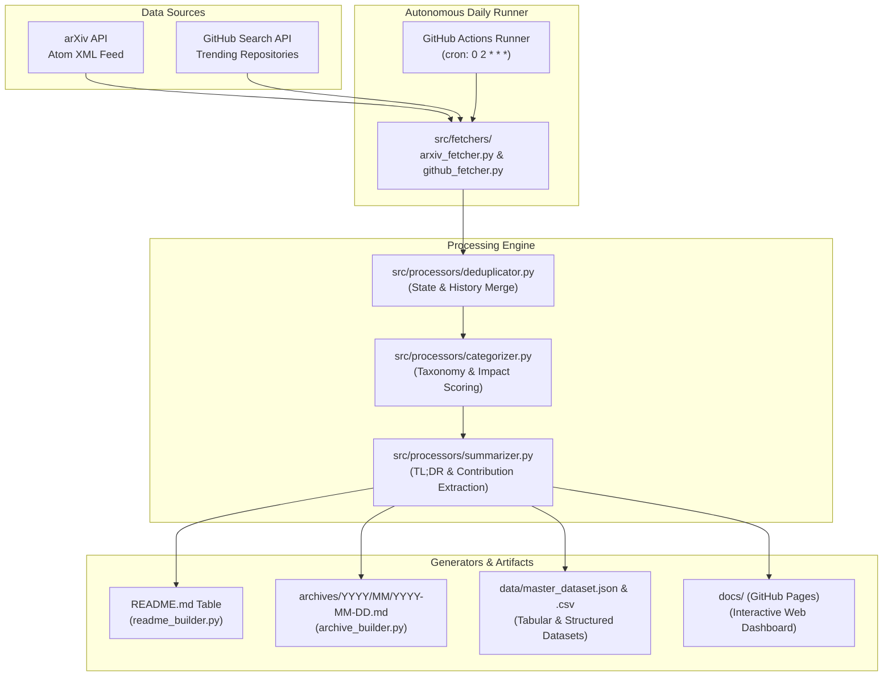

<div align="center">

# 📡 CortexRadar

### Autonomous AI Research, ML Breakthroughs & Trending Developer Tools Radar

[](.github/workflows/daily_update.yml)
[](https://cortexradar.github.io/cortex-radar/)
[](LICENSE)
[](https://www.python.org/)
[](CONTRIBUTING.md)

<p align="center">
  <strong>Zero-maintenance, self-updating intelligence pipeline tracking arXiv breakthroughs and high-velocity open-source repositories every 24 hours.</strong>
</p>

[**Explore Live Dashboard**](https://cortexradar.github.io/cortex-radar/) &bull; [**Browse Daily Archives**](archives/) &bull; [**Master Dataset (JSON)**](data/master_dataset.json) &bull; [**Master Dataset (CSV)**](data/master_dataset.csv) &bull; [**Fork & Customize**](#-how-to-fork--customize-in-30-seconds)

---

</div>

## 💡 Why CortexRadar?

Every day, over **800+ new AI/ML papers** are uploaded to arXiv and **thousands of repositories** are created on GitHub. Developers and researchers spend hours filtering through hype to find genuine technical breakthroughs and production-grade tools.

**CortexRadar solves this by providing:**
1. **Automated Daily Ingestion**: A fully autonomous GitHub Actions pipeline queries arXiv and GitHub APIs at `02:00 UTC` daily with zero paid API dependencies required out-of-the-box.
2. **Signal Filtering & Deduplication**: Extracts core contributions (TL;DR), cleans noise, categorizes into standardized AI domains, and calculates normalized impact scores.
3. **Multi-Channel Distribution**: Discovers are compiled into an auto-updating `README.md` leaderboard, permanent archival markdown reports (`archives/YYYY/MM/`), structured datasets (`JSON` & `CSV`), and a static web app.
4. **Instant Zero-Build Web Dashboard**: Deployable instantly to GitHub Pages with instant full-text search, domain filter pills, dark/light theme, and local bookmarking.

---

## ⚡ Today's Top Discoveries (Live Radar Digest)

The table below is generated and refreshed autonomously every 24 hours.

<!-- START_DAILY_UPDATE -->
> 📡 **Latest Daily Radar Digest:** `2026-11-24` | [🌐 Open Interactive Web Dashboard](https://cortexradar.github.io/cortex-radar/) | [📁 Browse Archives](archives/)

| # | Type | Discovery / Project | Category | Signal / Stars | Key Contribution (TL;DR) |
| :---: | :---: | :--- | :--- | :---: | :--- |
| **01** | `⭐ Repo` | **[affaan-m/ECC](https://github.com/affaan-m/ECC)** | 🤖 Agents & Systems | `⭐ 309.9k` | The agent harness performance optimization system. Skills, instincts, memory, security, and research-first development for Clau... |
| **02** | `⭐ Repo` | **[NousResearch/hermes-agent](https://github.com/NousResearch/hermes-agent)** | 🤖 Agents & Systems | `⭐ 265.8k` | The agent that grows with you. |
| **03** | `⭐ Repo` | **[firecrawl/firecrawl](https://github.com/firecrawl/firecrawl)** | ⚡ Dev Tools & Infra | `⭐ 208.4k` | Knowledge infrastructure to make your agents smarter. Search, scrape and access 550+ data providers through one API. |
| **04** | `⭐ Repo` | **[DietrichGebert/ponytail](https://github.com/DietrichGebert/ponytail)** | 🤖 Agents & Systems | `⭐ 197.8k` | Makes your AI agent think like the laziest senior dev in the room. The best code is the code you never wrote. |
| **05** | `⭐ Repo` | **[Significant-Gravitas/AutoGPT](https://github.com/Significant-Gravitas/AutoGPT)** | 🤖 Agents & Systems | `⭐ 188.2k` | AutoGPT is the vision of accessible AI for everyone, to use and to build on. Our mission is to provide the tools, so that you c... |
| **06** | `📄 Paper` | **[DeepSeek-R2: Reinforcement Learning for Test-Time Compute Scal...](https://arxiv.org/abs/2603.01892)** | 🎯 RL & Optimization | `⚡ 8.4` | Demonstrates pure RL scaling for multi-step test-time reasoning without human cold-start data. |
| **07** | `📄 Paper` | **[OmniWorld-1: Native Video-Audio-Action Foundation Models for R...](https://arxiv.org/abs/2603.02341)** | 👁️ Vision & Multimodal | `⚡ 8.1` | A unified multimodal foundation model predicting physical robotic actions directly from streaming sensory input. |
| **08** | `📄 Paper` | **[FlashAttention-4: Sub-Warp Micro-Tiling and Asynchronous Tenso...](https://arxiv.org/abs/2603.04510)** | ⚡ Dev Tools & Infra | `⚡ 7.7` | Pushes attention kernel efficiency to 93% GPU utilization with sub-warp scheduling and zero memory overhead. |

*Updated automatically every 24 hours at 02:00 UTC via [GitHub Actions](.github/workflows/daily_update.yml).*
<!-- END_DAILY_UPDATE -->

---

## 🖥️ Interactive Web Dashboard Preview

A sleek, responsive, zero-build client-side web application resides in [`docs/`](docs/) and is hosted live via **GitHub Pages**.

- 🔍 **Instant Full-Text Search**: Filter by author, model name, keyword, or repo. Press `/` to focus.
- 🏷️ **Domain Filtering**: One-click pills for *LLMs & Reasoning*, *Autonomous Agents*, *Vision & Multimodal*, *Dev Tools & Infra*, *RL & Optimization*.
- 📑 **Source Segments**: Toggle between ArXiv preprints, GitHub repositories, or your personal bookmarks.
- 🔖 **Client-Side Bookmarking**: Save high-signal papers and repos to `localStorage` without creating an account.
- 📥 **One-Click Export**: Download filtered views directly as a CSV dataset or copy Markdown citations.

👉 **[Launch Live Web Dashboard](https://cortexradar.github.io/cortex-radar/)**

---

## 🏗️ System Architecture & Workflow



---

## 🚀 How to Fork & Customize in 30 Seconds

Want to run your own custom radar for **Robotics**, **Biotech AI**, **Rust Dev Tools**, or **Crypto AI Agents**?

### Step 1: Fork this Repository
Click the **Fork** button at the top right of this page to create your own copy.

### Step 2: Edit `config.yaml`
All parameters are centralized in [`config.yaml`](config.yaml). Adjust categories, topics, or keywords without writing code:

```yaml
sources:
  arxiv:
    categories:
      - "cs.RO"   # Robotics
      - "cs.CV"   # Computer Vision
    max_results: 30

  github:
    topics:
      - "robotics"
      - "embodied-ai"
      - "ros2"
    min_stars: 10
```

### Step 3: Enable GitHub Actions & GitHub Pages
1. Go to your repository **Settings** &rarr; **Actions** &rarr; **General** &rarr; **Workflow permissions** &rarr; Select **Read and write permissions** &rarr; Click **Save**.
2. Go to **Settings** &rarr; **Pages** &rarr; Under **Build and deployment**, select **Deploy from a branch** &rarr; Branch: `main` &rarr; Folder: `/docs` &rarr; Click **Save**.
3. Go to **Actions** &rarr; Click **Daily Autonomous AI & Tech Radar Update** &rarr; Click **Run workflow**!

Your personal radar will now run autonomously every single day!

---

## 📂 Project Structure

```text
cortex-radar/
├── .github/
│   └── workflows/
│       └── daily_update.yml      # 24h cron & workflow_dispatch pipeline
├── archives/                     # Historical daily markdown digests (YYYY/MM/)
├── data/
│   ├── master_dataset.json       # Structured master record of all discoveries
│   └── master_dataset.csv        # Tabular CSV dataset for research & analysis
├── docs/                         # Static Web Dashboard (GitHub Pages)
│   ├── index.html                # Semantic HTML5 single-page application
│   ├── style.css                 # Modern responsive styling & dark/light theme
│   ├── app.js                    # Search, multi-filtering, sorting, bookmarking
│   └── data/                     # Synchronized dataset for client-side loading
├── src/
│   ├── fetchers/                 # ArXiv Atom XML & GitHub Search API fetchers
│   ├── processors/               # Deduplication, classification, and summarizer
│   ├── generators/               # README, Archive, and Dashboard builders
│   ├── config.py                 # YAML config schema loader & validator
│   ├── models.py                 # RadarItem dataclass & CSV/JSON serializers
│   └── pipeline.py               # Orchestrator coordinating all pipeline steps
├── tests/                        # Comprehensive unit test suite with pytest
├── config.yaml                   # Centralized configuration file
├── main.py                       # CLI entrypoint with --dry-run and --offline flags
├── requirements.txt              # Production and testing dependencies
├── CONTRIBUTING.md               # Contribution guidelines & setup instructions
├── CODE_OF_CONDUCT.md            # Contributor Covenant v2.1
└── LICENSE                       # MIT Open Source License
```

---

## 🛠️ Local Development & Testing

### Installation
```bash
# Clone repository
git clone https://github.com/cortexradar/cortex-radar.git
cd cortex-radar

# Create and activate virtual environment
python -m venv .venv
source .venv/bin/activate  # On Windows: .venv\Scripts\Activate.ps1

# Install dependencies
pip install -r requirements.txt
```

### Running the Pipeline
```bash
# Run standard daily update pipeline
python main.py

# Run in dry-run mode (fetches and processes without writing files)
python main.py --dry-run

# Run in offline mode (uses realistic fixtures without internet queries)
python main.py --offline
```

### Running Unit Tests
```bash
pytest -v --tb=short
```

---

## 🤝 Contributing

Contributions are warmly welcomed! Please check [CONTRIBUTING.md](CONTRIBUTING.md) for guidelines on adding new data sources, expanding taxonomy categories, or enhancing the dashboard UI.

---

## 📄 License

This project is open-source software licensed under the [MIT License](LICENSE).
arXiv preprints and GitHub repositories belong to their respective authors and license holders.
